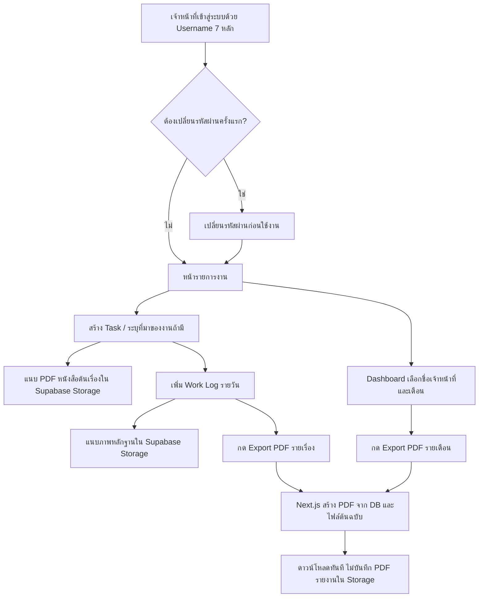

# Work Management & Reporting System
## Software Requirements Specification (SRS) — v4.0

**โครงการ:** ระบบบันทึกงานเจ้าหน้าที่และจัดทำรายงานผลการปฏิบัติงาน  
**เทคโนโลยี:** React + Next.js App Router + TypeScript + Supabase  
**วันที่ปรับปรุง:** 2 พฤศจิกายน 2569  
**สถานะ:** ข้อกำหนดสำหรับนำไปพัฒนาด้วย Codex / ทีมพัฒนา

> **เป้าหมาย:** เจ้าหน้าที่บันทึกงานเพียงครั้งเดียว เพิ่มบันทึกการปฏิบัติงานได้หลายวัน แนบหนังสือต้นเรื่อง PDF และรูปหลักฐาน แล้วสร้าง PDF รายเรื่องหรือรายบุคคลประจำเดือน **เมื่อกดดาวน์โหลด** พร้อม Dashboard ที่ค้นหาและเลือกดูรายชื่อเจ้าหน้าที่ได้

### ข้อกำหนดสำคัญที่ตัดสินใจแล้ว

1. **Frontend และ Server:** React + Next.js App Router + TypeScript; ใช้ Next.js Route Handlers / Server Components / Server Actions ตามความเหมาะสม
2. **Backend service เพียงแห่งเดียว:** Supabase (PostgreSQL, Authentication, Storage, Row Level Security และ Cron เมื่อจำเป็น) ไม่ใช้ Cloudflare R2 หรือฐานข้อมูลอื่น
3. **Username เจ้าหน้าที่:** ตัวเลข **7 หลัก** (`^[0-9]{7}$`), ไม่ซ้ำ, อาจมี `0` นำหน้า; เก็บเป็น `TEXT` ไม่ใช่ตัวเลข
4. **รหัสผ่านเริ่มต้นสำหรับเจ้าหน้าที่ใหม่:** **เหมือน Username ทุกหลัก** ตามข้อกำหนดขององค์กร เช่น `0123456` / `0123456`; ต้องเปลี่ยนเมื่อเข้าสู่ระบบครั้งแรก; ดูหัวข้อความปลอดภัยก่อนเปิดใช้งานจริง
5. **การสร้างบัญชี:** Admin เท่านั้น; ปิดการสมัครสมาชิกด้วยตัวเอง; บัญชี Admin ตั้งรหัสผ่านรัดกุมแยกต่างหาก
6. **ไฟล์ต้นฉบับ:** หนังสือคำสั่ง PDF และรูปภาพหลักฐานอยู่ใน Supabase Storage แบบ Private เพื่อใช้ออกรายงานย้อนหลัง
7. **PDF รายงาน:** สร้างใหม่แบบ on-demand เมื่อผู้ใช้กดดาวน์โหลด; ส่งกลับให้ดาวน์โหลดทันที **ไม่อัปโหลด PDF ที่สร้างแล้วเข้า Storage**
8. **ไฟล์อายุ 7 วัน:** ไม่ใช้กับ PDF รายงาน (เพราะไม่ได้จัดเก็บ) และ **ห้ามลบ PDF ต้นเรื่องหรือภาพหลักฐานอัตโนมัติ**; ถ้ามีไฟล์ชั่วคราว ให้ Cron ทำความสะอาดเฉพาะไฟล์ชั่วคราวตามนโยบายที่ระบุ
9. **ที่มาของงานและผู้มอบหมาย:** ยืดหยุ่น ชื่อผู้มอบหมาย/ชื่อฝ่ายต้นเรื่อง/เลขหนังสือ/ไฟล์คำสั่ง **ไม่บังคับ**
10. **ตัดฟิลด์:** ไม่ต้องมี `ปัญหาและอุปสรรค`, `วิธีแก้ไข`, `งานที่ต้องดำเนินการต่อ`, `ความคืบหน้า (%)` ทั้งฟอร์ม PDF และ Dashboard

---

## 1. ภาพรวมการทำงาน



**โครงสร้างข้อมูล:** แยก `tasks` (รายการงานหลัก) ออกจาก `work_logs` (สิ่งที่ทำจริงในแต่ละวัน) เพื่อให้งานหนึ่งเรื่องมีหลายบันทึกโดย Dashboard นับงานไม่ซ้ำ

## 2. บทบาทและสิทธิ์ผู้ใช้งาน

| Role | สิทธิ์หลัก |
|---|---|
| `staff` | สร้างงาน/บันทึกงานของตนเอง ดูหลักฐานและส่งออก PDF ในขอบเขตที่ได้รับสิทธิ์ |
| `supervisor` | ดูงานของบุคลากรที่รับผิดชอบ เลือกดู Dashboard รายบุคคล ตรวจรายงาน/ส่งกลับ |
| `manager` | ดูภาพรวมหลายทีม/หน่วยงานภายใต้สิทธิ์ ส่งออก PDF รายบุคคลและรายเดือน |
| `admin` | สร้าง/ปิดบัญชี รีเซ็ตรหัสผ่าน กำหนดฝ่าย/แผนก/หมวดงาน สิทธิ์ และตรวจ Audit |

- การอนุญาตต้องตรวจทั้ง **API** และ **Supabase RLS**; UI อย่างเดียวไม่ถือว่าปลอดภัย
- `admin` และ `supervisor` ไม่ได้สิทธิ์อ่านทุกไฟล์โดยอัตโนมัติ ต้องยึดขอบเขตองค์กร/ความรับผิดชอบ
- แยกสถานะผู้ใช้ `active`, `suspended` และแฟล็ก `must_change_password`

## 3. บัญชีผู้ใช้และการเข้าสู่ระบบด้วย Username 7 หลัก

### 3.1 ฟอร์ม Login

| ชื่อฟิลด์ | ชนิด | Validation | ตัวอย่าง |
|---|---|---|---|
| Username / เลขประจำตัวเจ้าหน้าที่ | `text` | **เลข 0–9 จำนวน 7 ตัว** ห้ามตัดเลขศูนย์ด้านหน้า | `0123456` |
| Password | `password` | ต้องไม่ว่าง | `0123456` (เฉพาะครั้งแรก) |

- ใช้ `inputMode="numeric"`, `maxLength={7}` สำหรับ Username แต่ **ใช้ input type="text"** เพื่อเก็บเลขศูนย์นำหน้า
- ปุ่ม `เข้าสู่ระบบ`, ปุ่มซ่อน/แสดง Password, แจ้งข้อผิดพลาดรวมว่า `ชื่อผู้ใช้หรือรหัสผ่านไม่ถูกต้อง`
- หน้า Login **ไม่มีปุ่มสมัครสมาชิกเอง**; ให้ติดต่อผู้ดูแลระบบเมื่อยังไม่มีบัญชี
- ไม่แสดงรหัสผ่านเริ่มต้นต่อสาธารณะในหน้า Login และไม่บันทึกรหัสผ่านใน log หรือ audit

### 3.2 วิธีใช้ Supabase Auth กับ Username

**ข้อเท็จจริงด้านเทคนิค:** Supabase Auth `signInWithPassword` ใช้อีเมลหรือเบอร์โทรศัพท์ร่วมกับ Password ไม่รองรับฟิลด์ Username โดยตรง ระบบจึงจัดเก็บ Username ของเจ้าหน้าที่แยกจาก identifier ภายในของ Supabase Auth

**วิธีที่เลือกสำหรับ v4:** Admin สร้างบัญชี Supabase Auth ผ่าน `auth.admin.createUser` จาก **Next.js Server เท่านั้น** โดยใช้ internal email identifier ที่สร้างจากเลขเจ้าหน้าที่และโดเมนที่องค์กรควบคุม เช่น `<username>@login.<org-owned-domain>` (ตัวอย่างเชิงโครงสร้าง ไม่ใช่โดเมนใช้งานจริง) และเก็บ `profiles.username` ไว้สำหรับแสดงผล/ค้นหา

**Login Flow:**

1. ผู้ใช้กรอก Username `0123456` และรหัสผ่าน
2. `POST /api/auth/login` ตรวจ regex และ rate-limit จากนั้นแปลง Username ไปเป็น Auth email ภายใน **บนเซิร์ฟเวอร์เท่านั้น** ด้วย domain ที่ตั้งค่าไว้เป็น environment variable
3. Next.js ใช้ Supabase SSR Auth client เรียก `signInWithPassword({ email: internalEmail, password })` จัดการ session cookie อย่างปลอดภัย
4. ตรวจ `profiles.is_active` และ `profiles.must_change_password`; ถ้ายังเป็นรหัสผ่านเริ่มต้นให้ส่งไป `/change-password` เท่านั้น
5. เมื่อรหัสผ่านเปลี่ยนสำเร็จและ server ยืนยันสถานะแล้ว จึงเข้าสู่ระบบทำงานตามปกติ

> **หมายเหตุด้านอีเมล:** internal email ต้องอยู่ภายใต้โดเมนที่องค์กรจัดการหรือ configuration ที่รองรับจริง ไม่ใช้กล่องจดหมายของผู้อื่น; อย่าพึ่งพาการรับอีเมลรีเซ็ตรหัสผ่านถ้าไม่ได้ตั้งค่า mailbox. การรีเซ็ตใน MVP ทำโดย Admin ผ่านระบบจัดการบัญชี

### 3.3 ขั้นตอนสร้างผู้ใช้โดย Admin

1. Admin ระบุ Username ตัวเลข **7 หลัก**, ชื่อ-นามสกุล, ตำแหน่ง/ฝ่าย, บทบาท
2. ตรวจ `^[0-9]{7}$` และตรวจความซ้ำด้วย DB `UNIQUE`
3. สร้าง Auth user ใน Supabase ผ่าน `auth.admin.createUser` โดยกำหนด `password = username` **เฉพาะรหัสผ่านเริ่มต้นของ Staff** และยืนยัน internal email ตาม flow ที่กำหนด
4. สร้าง `profiles` และ `user_roles` โดยกำหนด `must_change_password=true`, `is_active=true`
5. แสดง Username ต่อ Admin แต่ **ไม่เผยรหัสผ่านในหน้ารายการผู้ใช้/รายงาน/Log**; ส่งมอบข้อมูลครั้งแรกผ่านช่องทางภายในที่เหมาะสม
6. กรณี Auth user สร้างสำเร็จแต่การเขียน `profiles` ล้มเหลว ต้อง rollback/ทำเครื่องหมาย pending และ retry อย่างปลอดภัย ไม่ทิ้งบัญชี orphan ที่ใช้งานได้

> **ข้อยกเว้นสำหรับ Admin:** บัญชีสิทธิ์สูงต้องใช้รหัสผ่านที่คาดเดายากตั้งแต่สร้าง ห้ามใช้ Username 7 หลักเป็นรหัสผ่านเริ่มต้น และควรเปิด MFA

### 3.4 บังคับเปลี่ยนรหัสผ่านเมื่อเข้าครั้งแรก

- Path `/change-password` มี `รหัสผ่านใหม่`, `ยืนยันรหัสผ่านใหม่`, ปุ่ม `บันทึก` และ `ออกจากระบบ`
- รหัสผ่านใหม่ **อย่างน้อย 12 ตัวอักษร** มีความหลากหลายและไม่ตรงกับ Username/รหัสผ่านเริ่มต้น; ฝั่ง server ตรวจความยาว ความซ้ำ และกฎรหัสผ่านที่เหมาะสมกับ Supabase
- เมื่อ Auth password update สำเร็จ ให้ Next.js Server เปลี่ยน `profiles.must_change_password=false` ผ่าน server-side privileged operation หลังตรวจตัวตน
- ถ้า `must_change_password=true` ทุก Tasks/Dashboard/Reports/Storage data access ต้องถูกปฏิเสธ **ทั้งใน Route Handlers และ RLS** แม้ผู้ใช้ยิง API ตรง; อนุญาตเพียง login/change-password/logout/session สำหรับ flow นี้
- ห้ามให้ user เขียนค่า `must_change_password` เองผ่าน client; flag นี้แก้ได้เฉพาะ server/admin
- ออกจากระบบทุก session ที่ไม่จำเป็นหลังตั้งรหัสผ่านใหม่ และตรวจทบทวนการทำ token refresh/session invalidation

### 3.5 รีเซ็ตรหัสผ่าน / ป้องกันการเดา

- หน้า Admin มี `รีเซ็ตรหัสผ่าน` โดยตั้งรหัสผ่านชั่วคราวแบบสุ่มที่คาดเดายากเป็นค่าเริ่มต้น และกำหนด `must_change_password=true`
- หากองค์กรต้องการรีเซ็ตเป็น Username อีกครั้ง ต้องให้ Admin ยืนยันการกระทำนี้เป็นกรณีพิเศษ บันทึก Audit และบังคับเปลี่ยนครั้งแรก
- จำกัดความถี่ Login ตาม IP และ Username, หน่วงเวลาเมื่อผิดซ้ำ, ป้องกันบัญชีถูกเดาซ้ำ ๆ และแจ้งเตือน Admin เมื่อมีเหตุการณ์ผิดปกติ
- คืนข้อความผิดพลาดแบบเดียวกันทั้งกรณีไม่มี Username และ Password ผิด; ห้ามทำ public Username lookup endpoint
- ไม่เก็บ password plaintext หรือ custom password hash ใน `profiles`; Password จัดการโดย Supabase Auth เท่านั้น
- **Security warning:** การตั้งรหัสผ่านเริ่มต้นให้เท่ากับ Username 7 หลักมีความเสี่ยงสูง หากเผย Username หรือ Admin เปิดบัญชีไว้ก่อนส่งมอบ ผู้ไม่หวังดีสามารถเดารหัสได้ทันที; ต้องบังคับเปลี่ยนรหัสผ่าน, จำกัดความถี่การล็อกอิน และไม่ใช้กับ Admin

### 3.6 ข้อมูลผู้ใช้ในฐานข้อมูล

| Field | Type | Constraint |
|---|---|---|
| `user_id` | UUID FK → auth.users.id | PK |
| `username` | TEXT | `UNIQUE NOT NULL CHECK (username ~ '^[0-9]{7}$')` |
| `full_name` | TEXT | NOT NULL |
| `position` | TEXT | nullable |
| `department_id` | UUID | nullable |
| `must_change_password` | BOOLEAN | NOT NULL DEFAULT TRUE |
| `is_active` | BOOLEAN | NOT NULL DEFAULT TRUE |
| `created_at`, `updated_at` | TIMESTAMPTZ | server managed |

> สร้างตาราง `auth_login_attempts` สำหรับ rate-limit/audit เฉพาะ metadata ที่จำเป็น โดยจำกัด retention และไม่บันทึก Password

## 4. เมนูระบบ

1. Dashboard ภาพรวม
2. Dashboard รายบุคคล (ค้นหา/เลือกชื่อเจ้าหน้าที่)
3. รายการงานของฉัน / รายการงานในทีมตามสิทธิ์
4. เพิ่มงานใหม่
5. รายละเอียดงานและบันทึกการปฏิบัติงาน
6. ส่งออกรายงาน PDF รายเรื่อง
7. ส่งออกรายงาน PDF รายเดือน
8. ศูนย์แจ้งเตือน (งานใหม่/รายงานรอตรวจ/ส่งกลับแก้ไข; **ไม่ใช่แจ้งเตือน PDF หมดอายุ**)
9. ตรวจสอบ/รับรอง (ถ้าเปิดใช้)
10. ตั้งค่าระบบ / จัดการผู้ใช้งาน
11. เปลี่ยนรหัสผ่าน / โปรไฟล์

## 5. แบบฟอร์มรายการงานหลัก (Task)

| ฟิลด์ UI | DB field | จำเป็น | หมายเหตุ |
|---|---|---|---|
| เลขที่งาน | `task_code` | อัตโนมัติ | เช่น `TASK-2569-0001` |
| ชื่องาน / ชื่อเรื่อง | `title` | **ใช่** | ไม่เกิน 200 อักษร |
| ประเภทงาน | `category_id` | ไม่ | ค่าเริ่มต้น งานทั่วไป |
| รายละเอียดงาน / วัตถุประสงค์ | `description` | ไม่ | ข้อความหลายบรรทัด |
| ผู้รับผิดชอบ | `owner_user_id` | อัตโนมัติ | จากบัญชี login; Admin/หัวหน้าที่มีสิทธิ์เปลี่ยนได้ |
| ผู้ร่วมปฏิบัติงาน | `collaborators` | ไม่ | เลือกหลายคน |
| วันที่ได้รับงาน | `received_date` | ไม่ | อาจไม่ทราบวันที่แน่นอน |
| กำหนดส่งงาน | `due_date` | ไม่ | ไม่บังคับ |
| สถานะงาน | `task_status` | ใช่ | `กำลังดำเนินการ` / `เสร็จสิ้น` / `ยกเลิก` |

### 5.1 ฟอร์มที่มาของงาน (ทุกช่องไม่บังคับ)

| ฟิลด์ UI | DB field | หมายเหตุ |
|---|---|---|
| ที่มาของงาน | `source_type` | หนังสือจากต้นเรื่อง / บุคคลมอบหมาย / งานประจำ / อื่น ๆ |
| หน่วยงานต้นเรื่อง | `originating_unit` | รองรับหนังสือที่ส่งมาจากฝ่ายอื่นโดยไม่มีชื่อบุคคล |
| ผู้มอบหมายงาน | `assigner_name` | **ไม่บังคับ** |
| ตำแหน่งผู้มอบหมาย | `assigner_position` | ไม่บังคับ |
| เลขที่หนังสือ / คำสั่ง | `reference_no` | ไม่บังคับ |
| วันที่หนังสือ | `reference_date` | ไม่บังคับ |
| หมายเหตุ | `source_note` | ไม่บังคับ |
| แนบหนังสือต้นเรื่อง | `source_documents[]` | PDF หลายฉบับได้ ไม่บังคับ |

**Conditional Form:** หากเลือกงานประจำให้ซ่อนข้อมูลคำสั่งเป็นค่าเริ่มต้น หากเลือกหนังสือจากต้นเรื่องให้แสดงตัวกรอกเลขที่หนังสือและไฟล์ PDF โดยไม่บังคับกรอกชื่อผู้มอบหมาย การเปลี่ยนตัวเลือกต้องไม่ลบข้อมูลเดิมโดยไม่ยืนยัน

## 6. แบบฟอร์มบันทึกการปฏิบัติงาน (Work Log)

| ฟิลด์ UI | DB field | จำเป็น | หมายเหตุ |
|---|---|---|---|
| วันที่ปฏิบัติงาน | `work_date` | **ใช่** | ค่าเริ่มต้นวันนี้ |
| รายละเอียดการปฏิบัติงาน | `activity_detail` | **ใช่** | บันทึกสิ่งที่ทำจริง |
| ผลการปฏิบัติงาน | `result_text` | **ใช่** | สรุปผลลัพธ์ |
| เวลาเริ่ม / สิ้นสุด | `time_start`, `time_end` | ไม่ | ใช้เมื่ออยากสรุปชั่วโมง |
| ระยะเวลา | `duration_minutes` | ไม่ | คำนวณเมื่อมีข้อมูลเพียงพอ |
| จำนวนงาน / หน่วย | `quantity`, `unit` | ไม่ | เช่น 3 เอกสาร |
| ผู้บันทึก | `created_by` | อัตโนมัติ | ดึงจาก session |
| ภาพหลักฐาน | `evidence_images[]` | ไม่ | หลายรูป พร้อมคำบรรยายและลำดับ |

**ห้ามเพิ่ม:** ปัญหาและอุปสรรค, วิธีแก้ไข, งานที่ต้องทำต่อ, ความคืบหน้าร้อยละ หรือฟิลด์ชื่ออื่นที่สื่อความหมายเดียวกัน

## 7. ไฟล์หนังสือต้นเรื่องและรูปหลักฐาน — Supabase Storage

### 7.1 Buckets ทั้งหมดต้องเป็น Private

| Bucket | เก็บอะไร | อายุข้อมูล |
|---|---|---|
| `work-source-docs` | PDF คำสั่ง/หนังสือจากต้นเรื่อง | เก็บตามนโยบายเอกสารขององค์กร |
| `work-evidence` | JPG/PNG/WebP ภาพหลักฐาน | เก็บตามนโยบายเอกสารขององค์กร |
| `work-temporary` (optional) | Thumbnail ชั่วคราว, ไฟล์อัปโหลดไม่สำเร็จ, ไฟล์เตรียมการที่ใช้หมดแล้ว | ตั้งระยะหมดอายุ เช่น 7 วัน พร้อมตรวจสอบว่าไม่ถูกอ้างอิง |

- เอกสารต้นเรื่องรองรับหลาย PDF ต่อ Task; เบื้องต้นไม่เกิน 20 MB ต่อไฟล์ (ปรับได้)
- ภาพหลักฐานรองรับ JPG/PNG/WebP; เบื้องต้นไม่เกิน 10 MB ต่อรูป และ 15 รูปต่อ Work Log (ปรับได้)
- รูปแต่ละรายการมี `caption`, `evidence_type`, `display_order`, `include_in_pdf`, `created_at`
- ผู้ใช้สามารถดูตัวอย่าง จัดเรียง และติ๊กเลือกรูปที่จะรวม PDF
- ตรวจ MIME จริงจากเนื้อไฟล์, จำกัดขนาด, ป้องกัน path traversal, อัปโหลดด้วยชื่อ object ที่สุ่มเป็น UUID ไม่ใช้ชื่อผู้ใช้เป็น path
- RLS ต้องตรวจสิทธิ์อ่านไฟล์ตาม Task/Work Log/หน่วยงาน ไม่ใช่สิทธิ์ของ Bucket เพียงอย่างเดียว
- ใช้ authenticated request หรือ signed URL ระยะสั้นหลังตรวจสิทธิ์ ไม่สร้าง Public bucket หรือเปิดไฟล์ภายในสู่สาธารณะ
- ฝั่ง server ที่ใช้ `service_role` ต้องตรวจสิทธิ์ด้วยตนเองก่อนใช้งาน และห้ามส่ง secret ไป frontend

### 7.2 ห้ามลบหลักฐานตามรอบ 7 วัน

ไฟล์คำสั่งและภาพหลักฐานเป็น **ข้อมูลต้นฉบับ** ที่ระบบใช้สร้าง PDF ย้อนหลัง หากลบทิ้งแล้วจะไม่มีข้อมูลภาพหรือคำสั่งให้รวมในเอกสารใหม่ งาน cleanup จึงต้องทำเฉพาะ `work-temporary` และไฟล์ orphan ที่ผ่านการตรวจว่าปลอดภัยต่อการลบ

## 8. Dashboard รายบุคคล

**ส่วนกรองข้อมูล:** ค้นหารายชื่อเจ้าหน้าที่, เลือกบุคคลจาก dropdown, เลือกฝ่าย, เดือน/ปี, ประเภทงาน, สถานะ, ที่มาของงาน โดยแสดงเฉพาะเจ้าหน้าที่ตามสิทธิ์

**ตัวชี้วัด:**
- จำนวน **งานไม่ซ้ำ** ที่มี Work Log ในช่วงที่เลือก
- จำนวนครั้งที่บันทึกปฏิบัติงาน (Work Logs)
- งานเสร็จสิ้น / กำลังดำเนินการ / ยกเลิก
- จำนวนชั่วโมงปฏิบัติงานที่มีข้อมูลเวลา
- งานเกินกำหนด (เฉพาะงานที่กำหนด due date)
- กราฟจำแนกประเภทงาน และตารางรายการงานย้อนหลัง
- คอลัมน์ที่มาของงาน/หนังสืออ้างอิงเมื่อมีข้อมูล; กดเปิดภาพและ PDF ต้นเรื่องตามสิทธิ์

**วิธีนับ:** `COUNT(DISTINCT task_id)` จาก Work Logs ของบุคคลในช่วงวันที่; การนับ Work Logs และชั่วโมงต้องใช้ช่วงวันที่เดียวกัน แต่ status ณ วันสิ้นรอบต้องอาศัยประวัติสถานะ/สแนปช็อตเพื่อให้รายงานย้อนหลังถูกต้อง

**Interactive:** เปลี่ยนชื่อ/เดือนแล้ว KPI และรายการงานต้องเปลี่ยนทันที; กด KPI เพื่อเปิดรายการงานที่เป็นฐานคำนวณ; ปุ่ม `สร้าง PDF รายเดือน` ใช้ตัวกรองชุดเดียวกัน

## 9. สร้าง PDF รายเรื่องแบบ On-demand

**ผู้ใช้งาน:** เปิดหน้า Task → `ออกรายงาน` → เลือกบันทึกงาน รูป และเอกสารต้นเรื่อง → `ดาวน์โหลด PDF`

**เนื้อหา PDF A4:**
1. หัวเอกสารองค์กร / ชื่อรายงาน / รหัสงานและเลขที่รายงาน
2. ชื่อเจ้าหน้าที่ ฝ่าย/แผนก ชื่องาน สถานะ วันได้รับงาน/ช่วงปฏิบัติงาน
3. ที่มาของงาน **เท่าที่มี**; ไม่มีชื่อผู้มอบหมายก็ไม่แสดงช่องว่างที่ไม่จำเป็น
4. รายละเอียดงาน ตาราง Work Logs (วันที่ รายละเอียดงาน ผลลัพธ์)
5. สรุปผลการปฏิบัติงาน
6. ช่องผู้จัดทำ/ผู้ตรวจสอบเมื่อเปิด workflow รับรอง
7. ภาคผนวกภาพหลักฐานที่เลือก พร้อมคำบรรยายภาพ
8. ภาคผนวก PDF หนังสือต้นเรื่องที่ผู้ใช้เลือก โดยผนวกหน้าจริงต่อท้าย

**ค่าเริ่มต้น:** รวมภาพที่ติ๊กเลือก; แนบหนังสือต้นเรื่องเมื่อมีไฟล์ (สามารถยกเลิกได้); รองรับภาษาไทยและเลขหน้า A4

## 10. สร้าง PDF รายบุคคลประจำเดือนแบบ On-demand

**ผู้ใช้งาน:** Dashboard รายบุคคล → เลือกชื่อและเดือน → `ดาวน์โหลดรายงานประจำเดือน`

**เนื้อหา PDF A4:**
1. ชื่อเจ้าหน้าที่ ตำแหน่ง ฝ่าย/แผนก เดือน/ปี และเวลาที่สร้างรายงาน
2. KPI จำนวนงานไม่ซ้ำ, จำนวน Work Logs, งานเสร็จสิ้น, ชั่วโมงที่บันทึก
3. ตารางรายการงานในเดือน พร้อมวันที่ ชื่องาน ผลการทำงานย่อ และสถานะ
4. รายละเอียดงานที่เลือก (optional)
5. ภาคผนวกภาพหลักฐานที่เลือก (optional)
6. ภาคผนวก PDF หนังสือต้นเรื่อง (optional; **ปิดเป็นค่าเริ่มต้น** เพื่อไม่ให้รายงานยาวเกินไป)

**นโยบาย PDF รายงาน:**
- ทุกครั้งที่กดสร้าง/ดาวน์โหลด Next.js อ่านข้อมูลตามสิทธิ์จาก Supabase PostgreSQL และภาพ/PDF ต้นฉบับจาก Supabase Storage แล้วสร้างไฟล์ในหน่วยความจำหรือพื้นที่ชั่วคราวของคำขอเท่านั้น
- ส่งไฟล์กลับใน response: `Content-Type: application/pdf`, `Content-Disposition: attachment`, `Cache-Control: private, no-store`
- **ไม่สร้าง bucket `exports`, ไม่บันทึกไฟล์ PDF รายงานลง Storage, ไม่ต้องมี `expires_at` 7 วัน, ไม่ต้องมีปุ่มดาวน์โหลดไฟล์รายงานที่สร้างค้างไว้**
- หากผู้ใช้อยากได้รายงานใหม่ ให้กดสร้างอีกครั้งจากข้อมูลต้นฉบับ
- ข้อความในหน้า Export: `ระบบสร้างรายงาน PDF ใหม่ทุกครั้งที่ดาวน์โหลด และไม่ได้จัดเก็บไฟล์รายงานที่สร้างไว้ในระบบ ท่านสามารถกลับมาสร้างรายงานได้อีกจากข้อมูลที่มีสิทธิ์เข้าถึง`
- **ห้ามแสดงการแจ้งเตือนว่า PDF รายงานจะถูกลบเมื่อครบ 7 วัน** เพราะ PDF รายงานไม่ได้จัดเก็บไว้
- หากรายงานต้องมีหลักฐานฉบับรับรองที่เหมือนเดิมทุกครั้ง ให้เก็บ **snapshot ของข้อมูลและ revision ของหลักฐาน**; ถ้าต้องการให้ตรงกันระดับไฟล์ไบต์หรือใช้เป็นเอกสารทางการแบบตรึงฉบับ ต้องพิจารณาเก็บ PDF ฉบับรับรองเป็นข้อยกเว้น โดยได้รับการอนุมัตินโยบายก่อน

### 10.1 Technical PDF approach

- แนะนำใช้ HTML/CSS + headless Chromium renderer ฝั่ง Next.js server สำหรับ layout ไทย A4 แล้วใช้ `pdf-lib` ผนวก PDF ต้นเรื่องที่เลือก
- ระวัง limits ของ runtime บน Vercel สำหรับรายงานรูปภาพจำนวนมาก; ออกแบบระบบเป็น job/stream แบบขยายได้ในอนาคต โดย MVP ยังไม่มี Backend นอก Next.js + Supabase
- ต้อง escape/sanitize content, ป้องกัน SSRF จาก URL ภายนอก, ไม่โหลด URL ภาพอะไรก็ได้โดยไม่ตรวจสิทธิ์ และต้องจัดการ PDF เสียหาย/มีรหัสผ่านอย่างเป็นระบบ
- ใช้ฟอนต์ภาษาไทยที่มีสิทธิ์ใช้งานถูกต้อง; ทดสอบการตัดบรรทัดและหลายหน้า

## 11. การแจ้งเตือน (In-app Notifications)

คงเมนูไอคอนกระดิ่งและ `notifications` สำหรับเหตุการณ์ที่มีงานให้ดำเนินการ ไม่ใช่วันหมดอายุ PDF รายงาน

| เหตุการณ์ | ผู้รับ |
|---|---|
| มีงานที่มอบหมายใหม่ | ผู้รับผิดชอบ |
| มีงานที่รอตรวจ | หัวหน้างานที่มีสิทธิ์ |
| รายงานรับรองแล้ว | ผู้จัดทำ |
| รายงานส่งกลับให้แก้ | ผู้จัดทำ |
| ลบไฟล์ชั่วคราวล้มเหลวซ้ำ | Admin (ระบบดูแล) |

ฟิลด์ `notifications`: `id`, `recipient_user_id`, `type`, `entity_type`, `entity_id`, `title`, `body`, `read_at`, `created_at`, `dedupe_key`

## 12. Supabase Cron — ทำความสะอาดเฉพาะไฟล์ชั่วคราว (Optional)

หากระบบไม่ได้เก็บ PDF รายงานและไม่เหลือไฟล์ชั่วคราว **ไม่จำเป็นต้องเปิด Cron ลบไฟล์ PDF**

ถ้าเลือกเก็บไฟล์ชั่วคราว ให้รัน Supabase Cron ทุกวัน เช่น **02:00 น. เวลาไทย = 19:00 UTC ของวันก่อนหน้า** (ตรวจ timezone ของฐานข้อมูล/การตั้ง scheduler ใน deployment จริง) และเรียก Supabase Edge Function `cleanup-temporary-files`

การทำงานของ cleanup:
1. อ่านเฉพาะรายการ `temporary_files` ที่ `expires_at <= now()` และ `is_referenced=false`; ป้องกันการเลือกหลักฐานจริง
2. ตรวจว่า object อยู่ใน bucket `work-temporary` เท่านั้น
3. ใช้ **Supabase Storage API** ลบไฟล์ แล้วบันทึกผลสำเร็จ/ข้อผิดพลาด
4. รองรับ retry, idempotency, การทำงานซ้อน และ audit log
5. ไม่ลบ `work-source-docs` หรือ `work-evidence` ไม่ว่ากี่วันผ่านไป เว้นแต่องค์กรมีนโยบายใหม่และมี workflow อนุมัติที่ชัดเจน

**ไม่มี** Vercel Cron สำหรับลบรายงาน PDF และ **ไม่มี** Cloudflare R2 Lifecycle ใน v4

## 13. Database Schema (Logical)

| Table | คีย์สำคัญและบทบาท |
|---|---|
| `departments` | id, name, parent_id |
| `profiles` | user_id FK auth.users, **username TEXT UNIQUE CHECK 7 digits**, full_name, position, department_id, must_change_password, is_active |
| `user_roles` | user_id, role, scoped_department_id |
| `auth_login_attempts` | account_hash, ip_hash, attempted_at, successful; rate-limit/audit ตาม retention |
| `task_categories` | id, code, name, active |
| `tasks` | id, task_code, title, description, category_id, owner_user_id, received_date, due_date, task_status, timestamps |
| `task_collaborators` | task_id, user_id |
| `task_sources` | task_id, source_type, originating_unit, assigner_name NULL, assigner_position NULL, reference_no NULL, reference_date NULL, source_note NULL |
| `source_documents` | id, task_id, bucket, storage_key, original_name, mime, size_bytes, sha256, uploaded_by, created_at |
| `work_logs` | id, task_id, created_by, work_date, activity_detail, result_text, time_start, time_end, duration_minutes, quantity, unit, timestamps |
| `evidence_images` | id, work_log_id, bucket, storage_key, caption, evidence_type, display_order, include_in_pdf, sha256 |
| `task_status_history` | id, task_id, old_status, new_status, changed_by, changed_at |
| `reviews` | id, entity_type, entity_id, reviewer_id, status, note, timestamps |
| `report_snapshots` | id, report_type, subject_user_id, period_start, period_end, snapshot_json, revision, review_status, created_at (เฉพาะกรณีมีการรับรอง) |
| `notifications` | id, recipient_user_id, type, title, body, entity_type, entity_id, created_at, read_at, dedupe_key |
| `temporary_files` | id, bucket=`work-temporary`, storage_key, expires_at, is_referenced, deleted_at, retry_count |
| `file_cleanup_runs` | id, started_at, completed_at, processed, deleted, failed, status |
| `audit_events` | id, actor_id, entity_type, entity_id, action, safe_diff_json, created_at |

**ไม่มีใน v4:** `report_exports` ที่เก็บ PDF รายงานลง R2/Storage, `export_expires_at`, scheduled notification สำหรับ PDF หมดอายุ

### 13.1 ตัวอย่าง SQL สำหรับ Username ที่ต้องใช้ตั้งแต่ Migration

```sql
create table public.profiles (
  user_id uuid primary key references auth.users(id) on delete cascade,
  username text not null unique
    constraint username_exactly_7_digits check (username ~ '^[0-9]{7}$'),
  full_name text not null,
  position text,
  department_id uuid,
  must_change_password boolean not null default true,
  is_active boolean not null default true,
  created_at timestamptz not null default now(),
  updated_at timestamptz not null default now()
);

alter table public.profiles enable row level security;
-- เขียน RLS policy สำหรับการอ่าน/แก้ไขตามสิทธิ์
-- อย่าให้ authenticated role สามารถ UPDATE must_change_password ได้เอง
-- ห้ามให้ client บันทึก Password ลง public.profiles
```

> ตัวอย่างนี้เป็นเฉพาะโครงสร้างเริ่มต้น ยังไม่ใช่ migration ทั้งระบบ และต้องเพิ่ม Foreign Key / RLS policies ที่ครบถ้วนก่อน production

## 14. API Endpoints / Server Actions ที่แนะนำ

| Endpoint | หน้าที่ |
|---|---|
| `POST /api/auth/login` | รับ Username 7 หลัก/Password; rate-limit; แปลง Auth email ภายใน; ตั้ง session |
| `POST /api/auth/logout` | ออกจากระบบ |
| `POST /api/auth/change-password` | เปลี่ยนรหัสผ่านครั้งแรกและปิดแฟล็กหลังยืนยันสำเร็จ |
| `POST /api/admin/users` | สร้างบัญชี (เฉพาะ Admin) |
| `POST /api/admin/users/[id]/reset-password` | รีเซ็ตบัญชีและบังคับเปลี่ยนครั้งถัดไป |
| `GET/POST /api/tasks` | แสดง/เพิ่มรายการงาน |
| `GET/PATCH /api/tasks/[id]` | รายละเอียด/แก้ไขตามสิทธิ์ |
| `POST /api/tasks/[id]/work-logs` | เพิ่มบันทึกผลการปฏิบัติงาน |
| `POST /api/tasks/[id]/source-documents` | อัปโหลดหนังสือ PDF ไป Supabase Storage |
| `POST /api/work-logs/[id]/evidence` | อัปโหลดรูปหลักฐาน |
| `PATCH /api/evidence/[id]` | คำบรรยาย ลำดับ และรวมใน PDF |
| `GET /api/dashboard/individual?user_id=...&month=...` | Dashboard รายบุคคลตามสิทธิ์ |
| `POST /api/reports/single/download` | สร้างและส่ง PDF รายเรื่อง **โดยไม่บันทึก** |
| `POST /api/reports/monthly/download` | สร้างและส่ง PDF รายเดือน **โดยไม่บันทึก** |
| `GET/PATCH /api/notifications` | ศูนย์แจ้งเตือน |

ทุก endpoint ที่อ่าน/เขียนข้อมูลงานต้องตรวจ session, `is_active`, `must_change_password=false`, role/scoped department และ ownership ก่อนดำเนินงาน; รวมถึงตรวจไฟล์ที่ระบุใน `selected_evidence_ids` ว่าเป็นของงานนั้นจริง

## 15. โครงสร้าง Next.js App Router

```text
src/
  app/
    (auth)/login/page.tsx
    (auth)/change-password/page.tsx
    (protected)/layout.tsx
    (protected)/dashboard/page.tsx
    (protected)/dashboard/individual/page.tsx
    (protected)/tasks/page.tsx
    (protected)/tasks/new/page.tsx
    (protected)/tasks/[id]/page.tsx
    (protected)/tasks/[id]/logs/new/page.tsx
    (protected)/reports/single/page.tsx
    (protected)/reports/monthly/page.tsx
    (protected)/notifications/page.tsx
    (protected)/settings/users/page.tsx
    api/auth/login/route.ts
    api/auth/logout/route.ts
    api/auth/change-password/route.ts
    api/admin/users/route.ts
    api/admin/users/[id]/reset-password/route.ts
    api/tasks/route.ts
    api/tasks/[id]/route.ts
    api/tasks/[id]/work-logs/route.ts
    api/tasks/[id]/source-documents/route.ts
    api/work-logs/[id]/evidence/route.ts
    api/evidence/[id]/route.ts
    api/dashboard/individual/route.ts
    api/reports/single/download/route.ts
    api/reports/monthly/download/route.ts
    api/notifications/route.ts
  components/
    auth/login-form.tsx
    auth/change-password-form.tsx
    admin/user-form.tsx
    tasks/task-form.tsx
    tasks/work-log-form.tsx
    tasks/source-document-uploader.tsx
    evidence/evidence-uploader.tsx
    dashboard/employee-picker.tsx
    dashboard/kpi-cards.tsx
    reports/pdf-export-options.tsx
    notifications/notification-bell.tsx
  lib/
    supabase/browser.ts
    supabase/server.ts
    supabase/admin.ts        # server only
    auth/internal-identifier.ts
    auth/permissions.ts
    auth/rate-limit.ts
    pdf/generate-single.ts
    pdf/generate-monthly.ts
    pdf/merge-source-pdfs.ts
    storage/permissions.ts
    validations/auth.ts
    validations/tasks.ts
  types/
    database.ts
    index.ts
supabase/
  migrations/
  functions/cleanup-temporary-files/   # optional
```

**Environment variables (server only สำหรับ secret):** `NEXT_PUBLIC_SUPABASE_URL`, `NEXT_PUBLIC_SUPABASE_PUBLISHABLE_KEY`, `SUPABASE_SERVICE_ROLE_KEY`, `AUTH_INTERNAL_EMAIL_DOMAIN`; ห้ามใช้ prefix `NEXT_PUBLIC_` กับ secret key หรือ service role

## 16. กฎ UI/UX และข้อความเอกสาร

- ใช้ภาษาไทยเป็นหลัก วันที่แสดง พ.ศ. แต่จัดเก็บเป็น ISO/UTC ให้ถูกต้อง
- ฟอร์มกรอกง่าย ไม่บังคับผู้มอบหมายชื่อบุคคลหรือเลขที่หนังสือ
- ตัวเลือกไฟล์และภาพแสดง thumbnail, ความคืบหน้าอัปโหลด และคำบรรยาย
- สถานะงานแยกจากสถานะตรวจ/รับรอง ไม่ใช้เปอร์เซ็นต์ความคืบหน้า
- Dashboard เลือกชื่อบุคคลและเดือนที่ต้องการได้โดยไม่ต้องเปลี่ยนหน้าหรือโหลดใหม่ทั้งหน้า
- ข้อความ Login ครั้งแรก: `เพื่อความปลอดภัย กรุณาตั้งรหัสผ่านใหม่ก่อนเริ่มใช้งานระบบ`
- ข้อความหน้าส่งออก: `ระบบจะสร้าง PDF ใหม่ทุกครั้งที่ดาวน์โหลด โดยไม่เก็บไฟล์รายงานที่สร้างไว้ในระบบ`
- หากไม่มีหนังสือต้นเรื่อง/รูปภาพ ให้ PDF แสดงเฉพาะส่วนที่มีข้อมูลจริง

## 17. Acceptance Criteria / Test Cases

### บัญชีและความปลอดภัย

1. Admin สร้าง Username `0123456` ได้โดยไม่หายเลขศูนย์นำหน้า
2. Username `123456`, `12345678`, `12A4567` ถูกปฏิเสธ; Username ซ้ำถูกปฏิเสธ
3. Username `0123456` กับรหัสผ่านเริ่มต้น `0123456` login ได้เฉพาะบัญชี Staff ที่ Admin สร้างจริง
4. เมื่อ login ครั้งแรก ผู้ใช้อยู่ที่ `/change-password`; แม้เรียก Tasks/API/Storage ตรงก็อ่านข้อมูลไม่ได้
5. เมื่อเปลี่ยนเป็นรหัสผ่านใหม่สำเร็จ flag `must_change_password=false`; login ครั้งถัดไปด้วยรหัสเดิมต้องไม่ได้
6. User เปลี่ยน `must_change_password` เองผ่าน Supabase client/RLS ไม่ได้
7. Admin reset Password ได้; ระบบบังคับเปลี่ยนครั้งถัดไป; Admin account ไม่ใช้รหัส 7 หลักเป็นค่าเริ่มต้น
8. ทดลองเดารหัสหลายครั้งถูก rate-limit และไม่สามารถใช้ login endpoint ไล่หา Username ที่มีอยู่จริง

### งานและหลักฐาน

9. สร้างงานโดยไม่มีชื่อผู้มอบหมาย หนังสือต้นเรื่อง หรือฝ่ายต้นเรื่องได้
10. สร้างงานจากหนังสือของหน่วยงานต้นเรื่อง มี PDF แต่ไม่มีชื่อผู้มอบหมายได้
11. งานเดียวเพิ่ม Work Logs หลายวันได้; Dashboard รายบุคคลนับงานไม่ซ้ำ
12. อัปโหลดและจัดเรียงรูปหลายภาพ เลือกบางภาพแสดงใน PDF ได้จริง
13. PDF รายเรื่องสามารถผนวก PDF ต้นเรื่องหลายหน้าได้ และ PDF รายเดือนแนบเฉพาะเมื่อผู้ใช้เลือก
14. ไม่มีฟิลด์ `ปัญหา`, `วิธีแก้`, `งานต้องดำเนินการต่อ`, `ความคืบหน้า (%)` ใน UI/API/PDF หรือ Dashboard

### PDF และการเก็บไฟล์

15. เมื่อกด Export ระบบตอบกลับเป็น PDF ดาวน์โหลดได้ โดย **ไม่เกิด Storage object ใน bucket exports**
16. ดาวน์โหลดซ้ำได้จากข้อมูลต้นฉบับ แม้ไม่ได้เก็บ PDF ที่สร้างครั้งก่อน
17. ไฟล์ต้นเรื่องและรูปหลักฐานยังอยู่หลัง 7 วันและใช้สร้าง PDF ใหม่ได้
18. ไม่มีแจ้งเตือนหมดอายุ 48 ชั่วโมง / 24 ชั่วโมงสำหรับ PDF รายงานที่ไม่ถูกจัดเก็บ
19. หากเปิด Cron จะลบเฉพาะไฟล์ชั่วคราวที่หมดอายุและไม่ถูกอ้างอิง; ห้ามลบหลักฐานจริง
20. เอกสาร PDF ไทย A4 แสดงข้อความและภาพถูกต้อง รวมถึงหลายหน้าและกรณีไม่มีไฟล์แนบ
21. User ที่ไม่มีสิทธิ์ไม่สามารถเรียกดูรูป/PDF ต้นเรื่องของคนอื่นด้วย direct URL/API

## 18. ลำดับการพัฒนา

**Phase 1 — Core / Auth**
- Initialize Next.js/React/TypeScript/Tailwind/shadcn
- Supabase Auth + Username 7 หลัก + Admin create user + forced password change + RLS
- ตารางฝ่าย หมวดงาน ผู้ใช้ บัญชีและสิทธิ์

**Phase 2 — Tasks / Evidence**
- Task form และ Work Log หลายวัน
- อัปโหลด PDF ต้นเรื่องและรูปภาพไป Supabase Storage Private
- ค้นหา/แก้ไข/ดูรายละเอียดตามสิทธิ์

**Phase 3 — Reports / Dashboard**
- PDF รายเรื่องแบบ on-demand พร้อมรูป/หนังสือผนวก
- Dashboard เลือกรายบุคคล+เดือน, KPI, drill-down
- PDF รายเดือนแบบ on-demand

**Phase 4 — Review / Operations**
- วงจรตรวจรับรองและ snapshot รายงาน
- In-app notifications สำหรับงาน/การรับรอง
- Audit, security testing, backup/restore, optional Supabase Cron cleanup temporary files

## 19. รายการเปลี่ยนจาก v3 เป็น v4

| v3 | v4 |
|---|---|
| Cloudflare R2 เก็บต้นฉบับและ PDF ส่งออก | **Supabase Storage เก็บเฉพาะต้นฉบับ**, ไม่เก็บ PDF ส่งออก |
| Vercel Cron/R2 lifecycle ลบ PDF 7 วัน | **ยกเลิกระบบลบ PDF 7 วัน** เพราะไม่มีไฟล์ PDF รายงานที่จัดเก็บ; Cron optional เฉพาะ temporary |
| แจ้งเตือน PDF ใกล้หมดอายุ | ยกเลิก, เปลี่ยนเป็นแจ้งว่า PDF สร้างใหม่ทุกครั้ง |
| ระบบบัญชีไม่กำหนด Username | **Username เป็นตัวเลข 7 หลัก** เก็บแบบ TEXT UNIQUE |
| ไม่กำหนดรหัสผ่านเริ่มต้น | **Staff ใช้รหัสผ่านเริ่มต้นเท่ากับ Username**, บังคับเปลี่ยนทันที |
| ฟอร์มที่มาของงานยืดหยุ่น | คงเดิม; ไม่บังคับชื่อผู้มอบหมาย |
| Dashboard รายบุคคล / PDF สองแบบ | คงเดิม; ผูกกับ Supabase และสร้าง PDF on-demand |

---

## 20. References สำหรับทีมพัฒนา

- Supabase Auth password sign-in: https://supabase.com/docs/reference/javascript/auth-signinwithpassword
- Supabase Auth admin create user (server-only): https://supabase.com/docs/reference/javascript/auth-admin-createuser
- Supabase Storage private buckets: https://supabase.com/docs/guides/storage/buckets/fundamentals
- Supabase Storage RLS: https://supabase.com/docs/guides/storage/security/access-control
- Supabase Cron: https://supabase.com/docs/guides/cron

**เอกสารตัวอย่างรายงาน:** `sample_individual_work_report_v2.pdf` และ `sample_monthly_work_report_v2.pdf` เป็นไฟล์ตัวอย่างเนื้อหาจำลองจากข้อกำหนดเดิม; ก่อนใช้จริงให้ปรับข้อความส่วนอายุไฟล์ให้ตรงกับนโยบาย v4 ที่ไม่เก็บ PDF ส่งออก

**หมายเหตุส่งต่อ Codex:** ให้ใช้ข้อกำหนด v4 ฉบับนี้เป็น source of truth แทน v3 หากข้อกำหนดขัดกัน และให้ทำ database migrations, RLS และ security tests ก่อนเปิดใช้กับข้อมูลจริง
